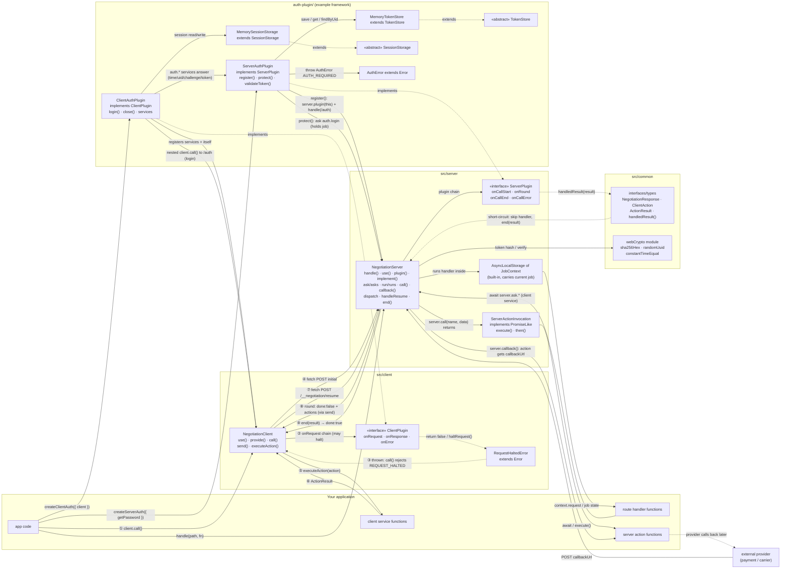

# Class Interaction Flow — all classes and how they interact

**Companion to `WORKFLOW.md`** (step flow) and **`CLASS-DIAGRAM.html`** (static UML).
This diagram is a *flow*: nodes are classes, edges are interactions (method calls,
creations, throws, implements/extends), numbered for the main negotiation sequence.

## All classes in the project

| # | Class | File | Kind | Role |
|---|---|---|---|---|
| 1 | `NegotiationClient<C>` | `src/client/NegotiationClient.ts` | exported | Client endpoint: `call()`, plugin chain, service execution |
| 2 | `NegotiationServer<C>` | `src/server/NegotiationServer.ts` | exported | Server endpoint: jobs, routes, rounds, callbacks |
| 3 | `ServerActionInvocation<T>` | `src/server/NegotiationServer.ts` | exported, `implements PromiseLike<T>` | Lazy server action returned by `server.call()` |
| 4 | `RequestHaltedError` | `src/common/negotiations.ts` | exported, `extends Error` | Thrown when a client plugin halts a request (`code: REQUEST_HALTED`) |
| 5 | `ClientAuthPlugin` | `auth-plugin/clientAuth.ts` | example framework, `implements ClientPlugin` | Auth client: services + token injection + auto-login |
| 6 | `ServerAuthPlugin` | `auth-plugin/serverAuth.ts` | example framework, `implements ServerPlugin` | Auth guard + login route + `protect()` held requests |
| 7 | `TokenStore` | `auth-plugin/stores.ts` | **abstract** | Server token registry storage (customization point) |
| 8 | `MemoryTokenStore` | `auth-plugin/stores.ts` | `extends TokenStore` | Default in-memory registry |
| 9 | `SessionStorage` | `auth-plugin/stores.ts` | **abstract** | Client session storage (customization point) |
| 10 | `MemorySessionStorage` | `auth-plugin/stores.ts` | `extends SessionStorage` | Default in-memory session |
| 11 | `AuthError` | `auth-plugin/authCore.ts` | `extends Error` | Coded auth errors (`AUTH_REQUIRED`, `CLOCK_SKEW`, ...) |

Also relevant (not classes): factories `createClient()` / `createServer()`, ready-made
instances `Client` / `Server`, the `AsyncLocalStorage<JobContext>` the server uses to
carry the current job into handlers, and interface types (`ClientPlugin`, `ServerPlugin`,
`ClientService`, `RouteHandler`, `ServerAction`, `JobContext`, `NegotiationResponse`, ...).

## Class interaction flow (Mermaid)

## The main sequence, class by class

1. **App → `NegotiationClient.call()`** — the only client entry point. Per-call state is
   local, so concurrent calls on one instance are safe.
2. **`NegotiationClient` → `ClientPlugin[]`** — `send()` runs `onRequest` hooks in
   registration order. A halt (false/throw/`haltRequest()`) makes it throw
   **`RequestHaltedError`**; `call()` rejects before any fetch.
3. **`NegotiationClient` → HTTP → `NegotiationServer.dispatch()`** — the server class
   offers the request to a pre-handler, then routes it: resume / external callback /
   new job.
4. **`NegotiationServer` → `ServerPlugin[]`** — `onCallStart` chain. `handledResult()`
   (a `common` factory, not a class) short-circuits: handler skipped, job ends with
   that result. A throw fails the job.
5. **`NegotiationServer` → your handler, inside `AsyncLocalStorage<JobContext>`** —
   this is how handler code, `server.ask`, and plugins all reach the same job without
   passing it explicitly.
6. **Handler → `NegotiationServer.ask/asks`** → server builds a round, rotates the
   resume token (hashed via `webCrypto`), fires `onRound`, replies `done:false`, and
   **suspends** — the `NegotiationServer` instance now holds the job in its `jobs` map.
7. **`NegotiationClient.executeAction()` → your service functions** — all actions of a
   round in parallel; results (or `ok:false` errors) are posted to
   `/__negotiation/resume`, and `handleResume()` wakes the handler (step 5 continues).
8. **Handler → `NegotiationServer.call()`** returns a **`ServerActionInvocation`** —
   a lazy `PromiseLike`: awaiting it executes the named server action; `callback()`
   consumes one to build the external-callback wait settled by the provider's POST.
9. **Handler return / `end()`** → `onCallEnd` plugins → `done:true` → job deleted →
   `NegotiationClient.call()` resolves. Any throw → `finishWithError()` →
   `onCallError` → `call()` rejects with the coded error.
10. **Auth classes (optional layer)** — `ClientAuthPlugin` *is* a `ClientPlugin` bound
    to a `NegotiationClient`, storing its session through `SessionStorage`;
    `ServerAuthPlugin` *is* a `ServerPlugin` on a `NegotiationServer`, storing tokens
    through `TokenStore`. `protect()` reuses step 6: the server asks the client's
    `auth.login` service, the client runs the login as a nested `call()`, and the held
    handler continues.

## Relationship summary

- **Implements:** `ClientAuthPlugin → ClientPlugin`, `ServerAuthPlugin → ServerPlugin`,
  `ServerActionInvocation → PromiseLike<T>`.
- **Extends:** `RequestHaltedError → Error`, `AuthError → Error`,
  `MemoryTokenStore → TokenStore`, `MemorySessionStorage → SessionStorage`.
- **Composition:** `NegotiationServer` ◆— jobs (`JobContext` values), plugins, routes,
  actions. `NegotiationClient` ◆— plugins, services.
- **Creation:** `createClient()`/`createServer()` factories (contract-typed),
  `Client`/`Server` prebuilt instances, `handledResult()` → `ServerPluginHandled`.
