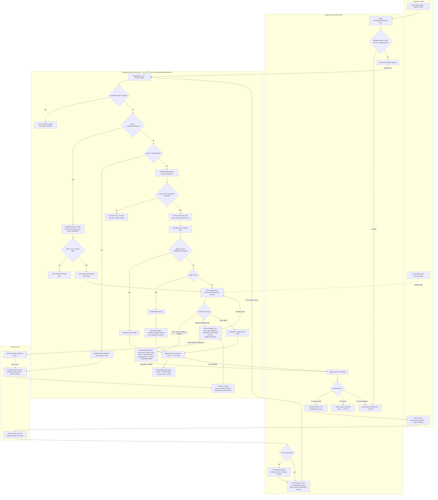

# HTTP Negotiation Protocol — Workflow Design

**Audience:** developer · **Detail level:** detailed · **Format:** Mermaid flowchart

## 1. Entry points

| Entry point | Where | Role |
|---|---|---|
| `client.call({ url, data, params?, headers?, signal?, maxRounds? })` | `src/client/NegotiationClient.ts` | Starts one logical call from application code |
| `server.requestHandler()` / `server.attach(httpServer)` / `server.handleRequest(req, res)` | `src/server/NegotiationServer.ts` | Your HTTP server hands every request to the protocol |
| `payments`/providers POST to a generated `callbackUrl` | `handleExternalCallback()` | External webhook entry point |
| Route handler `server.handle(path, handler)` | your code | Business logic; runs suspended across rounds |
| Client services `client.use({ name: fn })` | your code | Functions the server can ask the client to execute |

## 2. Main steps, functions, and modules

- **Client** (`NegotiationClient`): `call()` → round loop → `send()` (plugin chain + fetch) → `executeAction()` per asked service.
- **Shared** (`src/common/negotiations.ts`): wire types (`NegotiationResponse`, `ClientAction`, `ActionResult`), plugin types, `handledResult()`, `haltRequest()`, contract helpers (`defineContract`, `svc`/`act`).
- **Crypto** (`src/common/webCrypto.ts`): `sha256Hex` token hashing, `randomUuid`, `constantTimeEqual` (Web Crypto only).
- **Server** (`NegotiationServer`): `dispatch()` routes each HTTP request → `handleInitialRequest()` (creates a job) / `handleResume()` (continues a job) / `handleExternalCallback()`; the route handler suspends inside `requestClientActions()` (ask), `callback()` (external wait), and finishes via `end()` / `finishWithError()`.

## 3–6. Workflow diagram (data flow, decisions, external calls, outputs)

## 7. Each step in simple language

1. **You call `client.call()`.** One call from your code may internally become many HTTP requests; you only ever await the final answer.
2. **Client plugins get a say first.** Your `onRequest` plugins run before every fetch. One of them may stop the request entirely (`return false`, throw, `haltRequest()`) — then `call()` rejects with `REQUEST_HALTED` and nothing is sent.
3. **The first HTTP request reaches your server.** `dispatch()` first offers the request to a raw `setPreHandler` (if you set one), then checks: is this a *resume* (continuation), a *provider callback*, or a *new call*?
4. **New call → a "job" is born.** The server creates a job object in memory (with an overall expiry timer), runs `onCallStart` plugins, and starts your route handler. A plugin can answer the whole call itself via `handledResult(...)`, or fail it by throwing.
5. **Your handler runs "in slow motion".** When it awaits `server.ask...`, the server replies `done: false` plus a list of actions, and *freezes* the handler mid-function. Nothing about the HTTP connection is kept open.
6. **The client does the asked work.** All actions of a round run in parallel. Unknown services, timeouts, and failures become `ok: false` results instead of crashes.
7. **The client sends the results back** to `/__negotiation/resume` with a one-time resume token (rotated every round, stored server-side only as a SHA-256 hash). Bad token/round/results are rejected (403/409/400); good results *wake the handler exactly where it froze*.
8. **External waits work the same way.** `server.callback()` hands a provider a generated `callbackUrl` and freezes until the provider POSTs (or `callbackTimeoutMs` passes). Duplicate provider POSTs are acknowledged but ignored.
9. **Finishing.** When the handler returns (or calls `server.end(result)`), the server sends `done: true` with the result, runs `onCallEnd`, deletes the job, and `client.call()` resolves. If anything threw, the same path sends `done: true` with an `error` payload, `onCallError` runs, and `client.call()` rejects with a coded error.
10. **Side effects are memory-only.** Jobs live in one process, bounded by `maxJobs`, `requestTimeoutMs` (per round), and `jobTimeoutMs` (whole call). Nothing is written to a database; restarting the server loses in-flight jobs.

## 8. Error exits (summary)

| Situation | Wire result | `client.call()` |
|---|---|---|
| Client plugin halts | *(nothing sent)* | rejects `REQUEST_HALTED` |
| Unknown route / too many jobs | HTTP 404 / 503 | rejects with that HTTP error |
| Plugin/handler throws | `done:true` + `{ error }` (HTTP 200) | rejects with `error.code` |
| Bad resume token/round | HTTP 403 / 409 | rejects (job is dead) |
| Round exceeds `requestTimeoutMs` | job fails server-side | rejects on next response / timeout |
| Job exceeds `jobTimeoutMs` | job expired (`JOB_EXPIRED`) | rejects |
| Client exceeds `maxRounds` | — | rejects `MAX_ROUNDS_EXCEEDED` |
